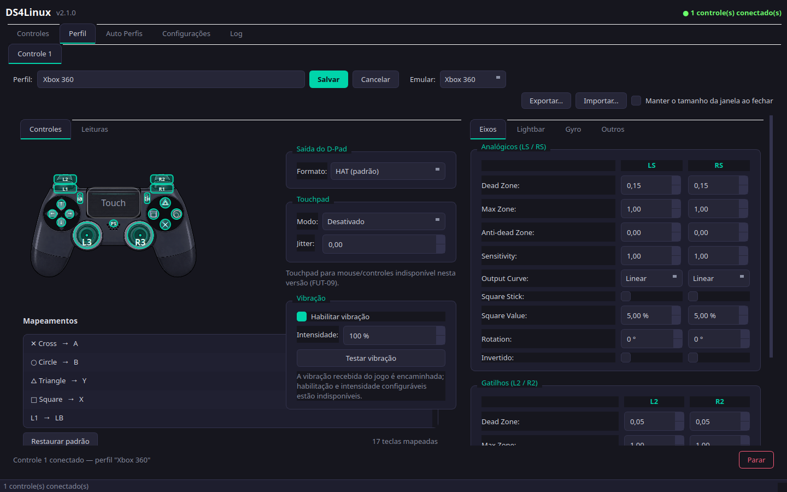
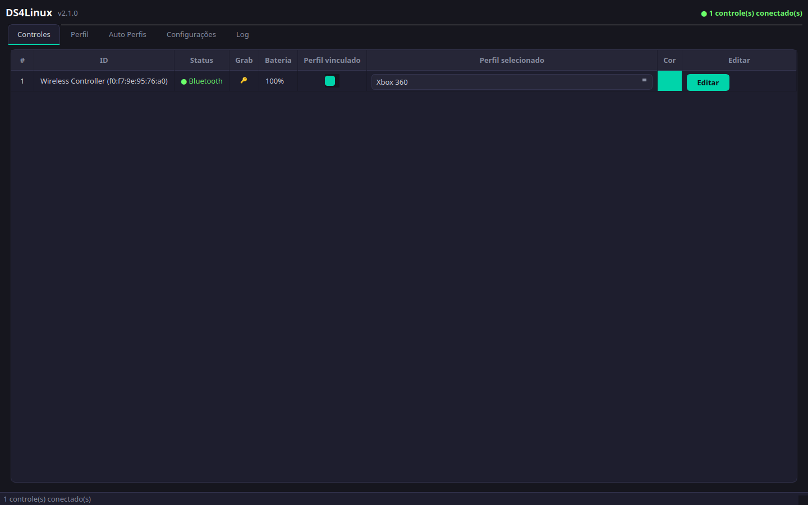
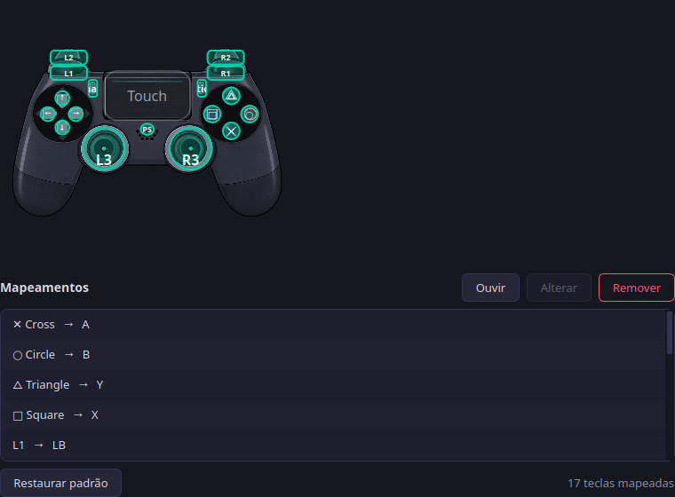
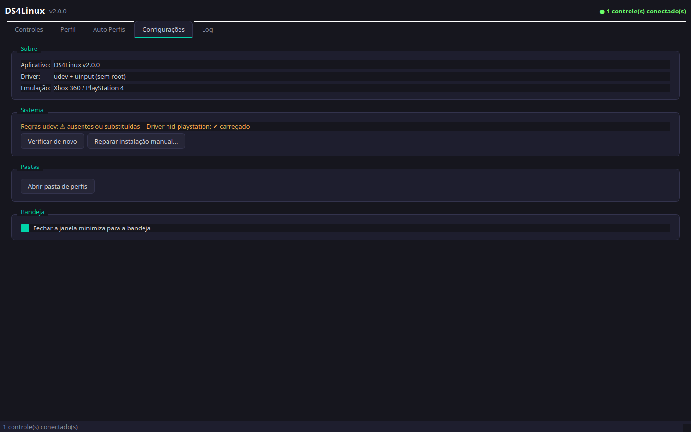
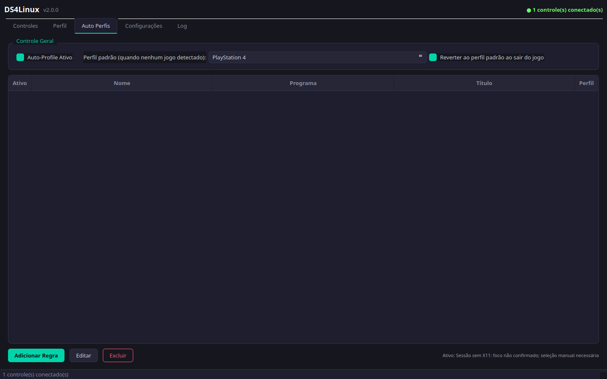

<p align="center">
  
</p>

<h1 align="center">DS4Linux 🎮</h1>

<p align="center">
  <b>Use your DualShock 4 as an Xbox 360 or PS4 virtual controller on Linux</b><br/>
  Visual remapping • Per-game profiles • Macros • LED and rumble • DSU motion
</p>

<p align="center">
  <b>English</b> • <a href="README.md">Português</a>
</p>

<p align="center">
  <a href="LICENSE"></a>
  <a href="https://github.com/FrancosCorporation/ds4linux/releases/latest"></a>
  
  
  
  <a href="https://github.com/FrancosCorporation/ds4linux/actions/workflows/tests.yml"></a>
</p>

---

## ✨ What is it

**DS4Linux** reads the events of a DualShock 4 (USB or Bluetooth), translates
evdev/HIDRAW into an **Xbox 360 or PS4 virtual device**, and sends rumble, LED
and motion back to the game or emulator:

1. Plug the controller in — it is detected automatically and the virtual
   device is created
2. Tune dead zone, curve, D-pad, buttons and lightbar in the **visual editor**
3. Save one profile per game and apply it manually or automatically

| 🎛 Controllers (status, battery, profile) | 🗺 Visual mapping |
|---|---|
|  |  |

| ⚙️ Settings | 🌗 Auto-profiles |
|---|---|
|  |  |

> These images are generated from the real UI by
> [`docs/generate_screenshots.py`](docs/generate_screenshots.py) — regenerate
> with `QT_QPA_PLATFORM=offscreen python docs/generate_screenshots.py`.

---

## ✅ What is implemented

| Feature | How it works |
|---|---|
| Two controllers | Independent slots, each with its own profile and LED |
| Virtual device | `uinput` as Xbox 360 or PS4, with buttons, axes and triggers |
| D-pad | Received as evdev buttons, evdev HAT or HIDRAW; the profile picks HAT output (default) or directional buttons |
| Fine tuning | Dead zone, max zone, anti-dead zone, sensitivity, curve, rotation and inversion per stick/trigger |
| Profiles | JSON per slot, validated import/export and button macros |
| LED and rumble | HID/sysfs reports and `EV_FF` forwarding when controller and system support it |
| Auto-profiles | By foreground window on X11; on Wayland the app states it cannot confirm focus and asks for manual selection |
| DSU motion | CemuHook/DSU UDP server on `127.0.0.1:26760` |
| “Readings” diagnostics | Compares physical event → mapping → virtual output, with export that strips device identifiers |
| Quality | 258 automated tests + GitHub Actions on every active branch |

**Not implemented yet** (the matching controls appear disabled in the UI):
gyro-to-mouse, calibration, touchpad gestures/modes, dynamic LED modes and
per-profile rumble intensity. Gyro motion streaming to DSU is available.
Behaviour depends on the controller, kernel and permissions — the automated
suite **does not** replace physical testing in games.

---

## 🎮 Supported controllers

Discovery uses Sony VID `054c` and the PIDs below, as declared in
`src/constants.py`:

| PID | Name | Status |
|---|---|---|
| `09cc` | DualShock 4 (v2) | ✅ recognised |
| `0ba0` | DualShock 4 (v2, other batch) | ✅ recognised |
| `05c4` | DualShock 4 (v1) | ✅ recognised |
| `0ce6` | DualSense | ⚠️ **not** in the current list |

“Recognised” means the code knows the ID — it is not a compatibility
certification for every connection, feature or game. Steam Input, SDL,
Proton/Wine and specific titles still need testing on the corresponding
hardware and runtime.

---

## 🚀 Installation

### 1. Debian package — Ubuntu 26.04 / Debian 13 (recommended)

Download [`ds4linux_<version>_all.deb`](https://github.com/FrancosCorporation/ds4linux/releases/latest)
from the Releases page, open it with your distribution's graphical installer
and confirm the administrative prompt **once**. Then launch **DS4Linux** from
the menu: it runs as your normal user and shows no privileged wizard on first
start.

| Step | What the package does |
|---|---|
| Dependencies | `python3-evdev`, `python3-pyudev`, `python3-pyside6.*` from the official repos ([Ubuntu 26.04](https://packages.ubuntu.com/resolute/amd64/python3-pyside6.qtwidgets) / [Debian 13](https://packages.debian.org/trixie/python3-pyside6.qtwidgets)) |
| Files | App in `/usr/lib/ds4linux`, assets in `/usr/share/ds4linux`, launcher `/usr/bin/ds4linux`, menu entry and icon |
| udev rules | Installs `99-z-ds4linux.rules` and reloads without prompts |
| First launch | Opens the main window directly — no mandatory setup |

> After installing or updating, **reconnect the controller** to apply the new
> permissions.

Clean-VM validation checklist (INSTALL-01):
[docs/validacao-deb.md](docs/validacao-deb.md) — use
`packaging/deb/verify-deb.sh` to inspect the package and re-check the
installation after `dpkg -i`.

The package installs its rule as `/usr/lib/udev/rules.d/99-z-ds4linux.rules`.
Because udev processes files in [lexical order](https://cgit.freedesktop.org/systemd/systemd/tree/man/udev.xml),
that rule is applied **after** any legacy
`/etc/udev/rules.d/99-ds4linux.rules` without deleting or editing it — an
administrative override with the same name still wins and shows up in the
app's diagnostics.

### 2. Arch Linux / AUR

The [`PKGBUILD`](packaging/arch/PKGBUILD) lives in `packaging/arch/` and can
be installed with any AUR helper:

```bash
yay -S ds4linux-git     # or paru, aura, …
```

It packages the wheel and installs the menu entry, icon, licence and the same
`99-z-ds4linux.rules` udev rule in `/usr/lib/udev/rules.d/` (the app's
diagnostics recognise that path as the package-managed rule), reloading the
rules after install/upgrade.

> ⚠️ The package is **not published to the AUR yet** — the `PKGBUILD` is in
> the repository. To publish it, run `makepkg --printsrcinfo > .SRCINFO` in
> `packaging/arch/` and submit it to the AUR. Note it is a development
> package (`-git`) tracking the branch.

### 3. From source (any distribution)

```bash
git clone https://github.com/FrancosCorporation/ds4linux.git
cd ds4linux
sudo ./install.sh
ds4linux
```

The installer needs privileges for dependencies, launcher, desktop entry and
udev rules. Start the GUI from your user session — **do not run DS4Linux as
root**. The rules use group `input`, mode `0660` and `uaccess` for the active
session; `/dev/uinput`, HIDRAW and LEDs do not need to be world-writable.
Reconnect the controller after installing.

### 4. Manual setup (without the installer)

```bash
sudo apt install python3 python3-pip python3-venv python3-dev build-essential \
  libevdev2 libevdev-dev libxcb-cursor0 libegl1
python3 -m venv .venv && . .venv/bin/activate
python -m pip install -r requirements.txt
python -m src.main

# udev rules (optional)
sudo install -D -m 0644 udev/99-ds4linux.rules /etc/udev/rules.d/99-ds4linux.rules
sudo udevadm control --reload-rules && sudo udevadm trigger
```

The application **opens even without udev rules**: the **Settings** tab shows
their state and offers optional repair. A password, when required, is asked
for by the system (polkit) and never stored by the app.

### 5. Build the package locally

```bash
packaging/deb/build-deb.sh
```

The file lands in `dist/`. Architecture is `all`; building neither installs
nor changes your host.

---

## ⚙️ Development and tests

```bash
python -m pip install -e .          # editable install
python -m src.main

python -m pip install -r requirements-ci.txt   # same environment as CI (Python 3.12)
QT_QPA_PLATFORM=offscreen python -m unittest discover -s tests -v
ruff check src tests
```

| Command | Purpose |
|---|---|
| `requirements-ci.txt` | Locked CI dependency matrix (`uv pip compile pyproject.toml --group dev --python-version 3.12 --python-platform x86_64-unknown-linux-gnu -o requirements-ci.txt`) |
| `python -m build --wheel` | Builds the wheel into `dist/` |
| `pip-audit -r requirements-ci.txt --strict` | Runs in CI on every push |
| `docs/generate_screenshots.py` | Regenerates the images in this README |

The suite covers synthetic evdev/HIDRAW translation, event frames and
recovery, profiles, lifecycle, offscreen GUI, installation into a temporary
directory and wheel resources. Real read/write of `/dev/input`, `uinput`,
HIDRAW, LEDs, rumble, Steam Input and games **still requires physical
validation**.

---

## 🔄 Input flow

```text
Physical controller ── exclusive evdev ─┐
                                        ├─ normalization/mapping ─ uinput ─ game
Physical controller ── optional HIDRAW ─┘
Game ── EV_FF ─ worker ─ HID/evdev ─ physical controller
Controller ── accelerometer/gyro ─ DSU UDP on loopback ─ emulator
```

When an evdev device exists, the program requires an exclusive `EVIOCGRAB`.
If Steam Input, `ds4drv` or another service already captured it, DS4Linux
**refuses** to create a parallel virtual output and shows the recommended
action. Running physical and virtual paths at once can duplicate inputs —
pick one capture path.

---

## 🗂️ Profiles

- `~/.config/ds4linux/profiles/<name>.json`
- `~/.config/ds4linux/config.json`

The schema uses version `1`, `device_type` (`xbox` or `ps4`) and
`dpad_output_mode` (`hat` or `buttons`), plus button maps, axes, triggers,
LED, polling and macros. Imported files are validated and unknown schema
versions are rejected. Map codes are Linux `EV_KEY` codes, not SDL key names.

---

## 🔍 Troubleshooting

| Symptom | What to do |
|---|---|
| Controller does not connect | Reconnect after installing the rules; check access to the `event*` node and `/dev/uinput`; look for `EVIOCGRAB` errors in the log |
| Steam Input / another service captured it | Disable one of the paths, reconnect and retry — the app does not create a duplicated physical/virtual input when the grab fails |
| D-pad directions do not navigate in game | In the profile tab use **Flow diagnostics** and capture a press **and** a release; try both HAT and directional-button output. The capture shows what DS4Linux wrote, not what the game consumed |
| Game does not see the virtual pad | Start DS4Linux **before** the game, inspect the node with `evtest` and try Xbox/PS4. No universal compatibility is claimed |
| LED or rumble does nothing | Confirm controller/driver support and udev permissions; the log distinguishes missing path, permission denied and device error |
| Auto-profile never switches | Focus cannot be confirmed on Wayland — select the profile manually |
| Qt/XCB error | On Debian/Ubuntu install `libxcb-cursor0` and use the Qt session supported by your desktop |

Re-run the automated D-pad regression:

```bash
QT_QPA_PLATFORM=offscreen python -m unittest tests.test_dpad tests.test_worker_dpad -v
```

---

## 📊 Project status

- **Version:** 2.1.0 (development branch) — changes in
  [CHANGELOG.md](CHANGELOG.md), releases on the
  [repository tags](https://github.com/FrancosCorporation/ds4linux/releases)
- **Backlog, evidence and pending validation:** [plan.md](plan.md)
- **Implementation and test history:** [resumo.md](resumo.md)
- Security policy: [SECURITY.md](SECURITY.md)
- `version_2.1` is the development branch name, aligned with this version

---

## 🤝 Contributing

The full flow — environment, suite, lint, commit style and what gets
reviewed — is in [CONTRIBUTING.md](CONTRIBUTING.md). In short:

1. Create a branch for the change
2. Add a regression test for the changed contract
3. Run the offscreen suite and `ruff check src tests`
4. Update `CHANGELOG.md`, `plan.md` and `resumo.md` when the backlog changes

---

## 📄 License

MIT — use, modify and share freely. See [LICENSE](LICENSE).

## 🙏 Acknowledgements

- [python-evdev](https://github.com/gvalkov/python-evdev)
- [PySide6 / Qt for Python](https://wiki.qt.io/Qt_for_Python)
- [pyudev](https://pyudev.readthedocs.io/)
- The `hid-playstation` and `uinput` kernel subsystems
